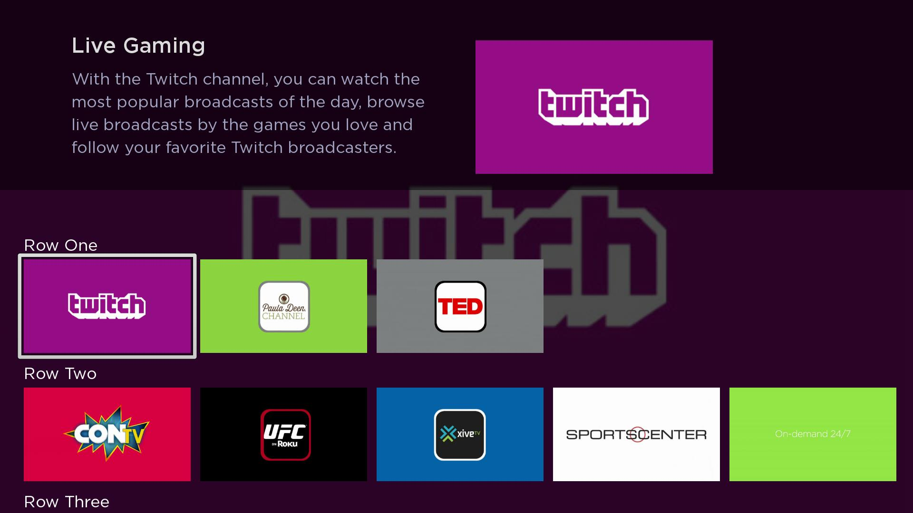

# SDK-Development-Guide has moved to GitLab

**This project has moved.** Development now continues at **https://gitlab.com/rokudev/SDK-Development-Guide**.

This GitHub repository is archived and read-only. It is kept only as a pointer to the new home. Please open new issues and merge requests on GitLab.

---

# SDK Development Guide

## Overview

The guide covers some key concepts to building your first Roku channel. Before proceeding, please review:

* [Developer Setup Guide](https://developer.roku.com/develop/getting-started/setup-guide) to enable developer settings on your Roku device
* [Hello World Guide](https://developer.roku.com/develop/getting-started/sdk-hello-world) to understand how to side-load a channel

This guide is composed of the following sections:

### 1. [Setting up a project](/project-setup.md)

How to setup a project with the required directories, files, and assets.

### 2. [Parsing an XML content feed](/parsing-feed.md)

How to parse a content feed and retrieve videos, titles, descriptions, etc.

### 3. [Building a user interface in SceneGraph](/scenegraph-ui.md)

How to build a basic grid layout using the `RowList` component.

### 4. [Playing video](/video-playback.md)

How to setup and play video in SceneGraph.
